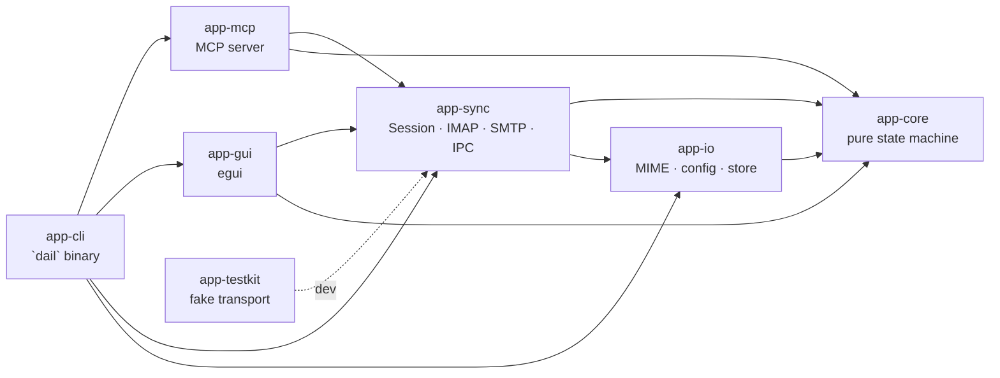
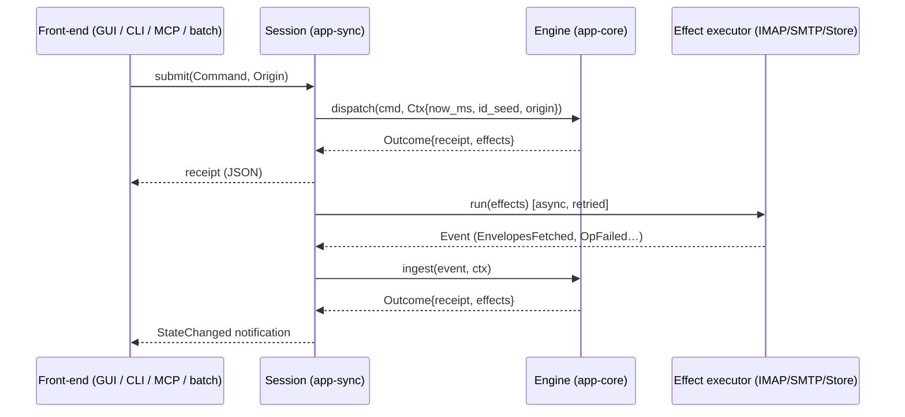

# dail — Architecture

Agent-first desktop email client. Every action is a serializable `Command`. The GUI, the CLI, batch scripts and the
built-in MCP server are four equal front-ends to one deterministic engine.

- Rules for contributors and agents: [`AGENTS.md`](AGENTS.md)
- Delivery plan: [`ROADMAP.md`](ROADMAP.md)

---

## 1. Principles

1. **Headless first.** If an action can't be done from `dail exec`, it doesn't exist yet.
2. **Sans-IO core.** `app-core` is a pure state machine: `(State, Command|Event, Ctx) → (State', Receipt, Effects)`.
3. **Local-first, optimistic.** The UI reflects intent immediately. The network catches up through a pending-op queue.
4. **One registry, many surfaces.** Palette, CLI help, MCP tools and keybindings all come from `Command::specs()`.
5. **Replayable.** Commands and events are logged as JSONL. Bugs are reproduced by replaying a log, not by clicking around.
6. **Email is hostile input.** Content never gains authority over the agent or the app.
7. **Minimal UI.** Three panes, one accent colour, keyboard everything, Ctrl+K for the rest.

## 2. Scope (current)

| | Now | Later |
|---|---|---|
| Platforms | Ubuntu (X11/Wayland), Windows | macOS, Web/PWA (Android/iOS) |
| Protocols | IMAP4rev1 (+UIDPLUS, MOVE, SPECIAL-USE if offered), SMTP submission | IDLE/CONDSTORE/QRESYNC, JMAP, Gmail API |
| Auth | Password / App Password (keyring-stored) | OAuth2 XOAUTH2 (Gmail, M365) |
| Providers | Hostinger Mail, Gmail, generic custom | autoconfig discovery |

## 3. Workspace topology



There is a single binary, `dail` (`app-cli`). It hosts every mode:

```text
dail gui                         # start desktop app (default when no subcommand)
dail exec archive_threads --args '{"ids":["…"]}'
dail batch script.jsonl          # or: … | dail batch -
dail schema [--command NAME]     # JSON Schema of Command/Event (what MCP exposes)
dail mcp [--allow-send]          # MCP over stdio; attaches to a running GUI if present
dail account add --preset gmail --email me@gmail.com   # alias for exec add_account
```

## 4. Core model (`app-core`)

### 4.1 Data flow



`Session` is the only place that owns an `Engine`. It is single-writer: commands and events are serialized through
one `tokio::mpsc` queue, so the engine needs no locks.

### 4.2 Types

```rust
// ids.rs — newtypes over Uuid / u64; all Copy + Ord + Serialize + JsonSchema
AccountId, MailboxId, MessageId, ThreadId, DraftId, OpId, ApprovalId

// state.rs
pub struct AppState {
    pub accounts:  IndexMap<AccountId, Account>,
    pub mailboxes: IndexMap<MailboxId, Mailbox>,
    pub messages:  IndexMap<MessageId, Envelope>,     // metadata only; bodies via Store
    pub threads:   IndexMap<ThreadId, Thread>,
    pub drafts:    IndexMap<DraftId, Draft>,
    pub outbox:    IndexMap<OpId, PendingOp>,          // remote ops not yet confirmed
    pub approvals: IndexMap<ApprovalId, ApprovalRequest>, // agent sends awaiting the user
    pub view:      ViewState,                          // selection, open mailbox, palette, search
    pub settings:  Settings,
}

pub struct Account  { id, display_name, email, preset: ProviderPreset, imap: Endpoint, smtp: Endpoint,
                      secret: SecretRef, status: SyncStatus }
pub struct Mailbox  { id, account, path: String, role: Option<MailboxRole>, uid_validity: Option<u32>,
                      uid_next: Option<u32>, unread: u32, total: u32 }
pub enum  MailboxRole { Inbox, Sent, Drafts, Trash, Archive, Junk, All, Flagged }
pub struct Envelope { id, account, mailbox, uid: u32, message_id_hdr: Option<String>, in_reply_to, references,
                      thread, from: Vec<Addr>, to, cc, subject: String, date_ms: i64, flags: Flags,
                      size: u32, has_attachments: bool, body: BodyState /* NotFetched|Fetched{blob}|Failed */ }
pub struct Thread   { id, messages: Vec<MessageId>, last_date_ms: i64, subject: String }
pub struct Draft    { id, account, reply_to: Option<MessageId>, to, cc, bcc, subject, body_text,
                      attachments: Vec<AttachmentRef>, send_at: Option<i64> }
pub struct PendingOp{ id, account, op: RemoteOp, attempts: u32, last_error: Option<String>, created_ms }
```

Gmail exposes the same message in several folders. `MessageId` is per `(mailbox, uid)`. Threads group messages
across folders by `Message-ID`/`References` (a JWZ-lite threading algorithm, pure, in `app-core::threading`).

### 4.3 Command / Event / Effect

- **`Command`** — intent from a front-end (§8 catalogue). `#[serde(tag = "cmd", content = "args", rename_all = "snake_case")]`.
- **`Event`** — a world fact, produced only by the runtime: `AccountVerified`, `MailboxesListed`, `EnvelopesFetched`,
  `BodyFetched`, `FlagsChanged`, `RemoteOpSucceeded`, `RemoteOpFailed`, `MessageSent`, `SendFailed`, `SyncFailed`, `Tick{now_ms}`.
- **`Effect`** — a request to the world: `VerifyAccount`, `ListMailboxes`, `FetchEnvelopes{mailbox, since_uid, limit}`,
  `FetchBody{message}`, `RunRemoteOp{op}`, `SmtpSend{draft}`, `AppendMessage{mailbox, blob}`, `StoreSecret`,
  `DeleteSecret`, `PersistState`, `ScheduleTick{at_ms}`.
- **`CommandReceipt`** — `{ ok, kind, affected: Vec<EntityRef>, data: serde_json::Value, undo_label: Option<String> }`.
  Query results travel in `data`.

### 4.4 Undo / redo semantics

| Kind | Mechanism |
|---|---|
| `Mutation` | `HistoryEntry { forward: Command, inverse: Vec<Command> }`. Undo dispatches the inverse, which also emits compensating remote ops. If the original op is still pending, it is cancelled in the outbox instead of round-tripping. |
| `Outbound` | `send_draft` sets `send_at = now + settings.undo_send_ms` (default 10 s). The Session schedules a `Tick`. Undo before then returns the message to Drafts. After the tick it is irreversible. |
| `Destructive` | Requires `confirm: true`. Not undoable. The receipt says so. |
| `Query` / `View` | Not recorded. |

Undo history is per session, in memory, capped (default 200). Undo is a `Command`, so agents can undo too.

### 4.5 Command registry

```rust
pub struct CommandSpec {
    pub name: &'static str,        // "archive_threads" — equals the serde tag
    pub title: &'static str,       // "Archive" — palette label
    pub category: Category,        // Mail, Navigation, Compose, Account, App
    pub kind: CommandKind,
    pub default_keys: &'static [&'static str], // ["e"]
    pub available: fn(&AppState) -> bool,      // palette/menu filtering; MCP returns a structured error
}
```

The **parity test** (in `app-mcp` and `app-cli`) asserts that every `CommandSpec.name`:

- appears in the MCP tool list,
- round-trips through `dail exec` JSON parsing,
- has a JSON Schema,
- appears in the GUI palette source.

## 5. Runtime (`app-sync`)

### 5.1 Session
`Session::open(profile_dir, Backend)` loads config and state snapshot from the Store, then spawns:

- the **engine task**: the single-writer loop over `mpsc<Input{Command|Event}>`;
- the **effect executor**: one worker per account, holding one IMAP connection, a lazy SMTP connection, and
  exponential back-off on failures;
- the **ticker**: polls INBOX every `settings.poll_secs` (default 120 s) and fires scheduled sends;
- the **IPC listener** (GUI mode).

`Backend` is a trait object with `Live` (IMAP/SMTP) and `Memory` (app-testkit) implementations. `--backend memory` exists for
smoke tests and demos.

### 5.2 Sync model (MVP)
1. `LIST` with SPECIAL-USE gives mailboxes and roles. Roles fall back to the preset mapping and then to name heuristics.
2. For each subscribed mailbox: `SELECT`, compare `UIDVALIDITY` (if it changed, drop the cached mailbox), then `UID FETCH (since uid_next)`
   for envelopes, flags, `BODYSTRUCTURE` and size. The initial window is the newest `N = settings.initial_window` (default 500).
3. Flag resync for the cached window uses `UID FETCH 1:* (FLAGS)` (CONDSTORE in Wave 2).
4. Bodies are lazy: `FetchBody` runs when a message is opened. Prefetch covers the top 20 unread INBOX messages. The raw RFC 822 is stored as a blob,
   parsed by `app-io::mime`.
5. Remote ops: `UID STORE`, `UID MOVE` (fallback `COPY` + `STORE \Deleted` + `UID EXPUNGE`), `APPEND`.

### 5.3 Provider presets

| Preset | IMAP | SMTP | Archive | Sent copy | Notes |
|---|---|---|---|---|---|
| `hostinger` | imap.hostinger.com:993 TLS | smtp.hostinger.com:465 TLS | move → `Archive` (create if missing) | APPEND to Sent | |
| `gmail` | imap.gmail.com:993 TLS | smtp.gmail.com:465 TLS | move INBOX → `[Gmail]/All Mail` | SMTP saves it automatically, so skip APPEND | App Password (2FA required); trash = move to `[Gmail]/Trash` |
| `custom` | user-supplied | user-supplied | SPECIAL-USE `\Archive` or `Archive` | APPEND | STARTTLS on 143/587 supported |

TLS: rustls + ring with `webpki-roots`. Plaintext connections are refused.

### 5.4 Single instance & IPC attach
The GUI owns the profile lock (`profile_dir/lock`) and listens on a local socket (Unix domain socket / Windows named pipe, via
`interprocess`). It speaks newline-delimited JSON-RPC `{"id","method":"submit","params":Command}`. `dail exec`, `dail batch` and
`dail mcp` first try to attach. If no GUI is running they open the profile themselves (and take the lock). This way an agent
always drives the same state the user is looking at, and the GUI repaints live when an agent archives a thread.

## 6. Storage (`app-io`)

```text
<data_dir>/dail/profiles/<name>/          # directories::ProjectDirs (XDG on Linux, %APPDATA% on Windows)
  config.toml        # accounts (no secrets), settings, keymap overrides
  state.redb         # tables: mailboxes, envelopes, threads, drafts, outbox, approvals, meta(schema_version)
  blobs/ab/cd…eml    # content-addressed raw messages (sha256)
  logs/replay-YYYYMMDD.jsonl   # {"t":ms,"origin":"mcp","input":{"command":…}|{"event":…}} — bodies/secrets redacted
```

- `Store` trait: `load_snapshot`, `apply(PersistDelta)`, `put_blob`, `get_blob`. Implementations: `RedbStore`, `MemoryStore`.
- Persistence is an `Effect` (`PersistState{delta}`), so the engine stays pure.
- `meta.schema_version` plus forward-only migrations in `app-io::store::migrations`.

## 7. Front-ends

### 7.1 GUI (`app-gui`)
```text
┌────────────┬──────────────────────────┬──────────────────────────────────┐
│ ▸ Inbox 12 │ ● Alice   Q3 numbers  9:41│ Q3 numbers                        │
│   Starred  │   Bob     Lunch?      9:02│ Alice <alice@…> → me   Today 9:41 │
│   Sent     │   GitHub  [dail] PR … Tue │                                   │
│   Archive  │                          │ Hi, attached are…                 │
│   Trash    │                          │                                   │
│ ─ work@…   │                          │ [r] reply [a] all [f] fwd [e] arch│
├────────────┴──────────────────────────┴──────────────────────────────────┤
│ ⟳ synced 1m ago · 2 pending · "Archived 3 threads — Undo (z)"   Ctrl+K   │
└──────────────────────────────────────────────────────────────────────────┘
```
- **Palette (Ctrl+K / Ctrl+Shift+P):** fuzzy match (`nucleo-matcher`) over the available `CommandSpec`s plus mailboxes and recent threads.
  Commands with arguments open a second-step picker (e.g. *Move to…* lists mailboxes), driven by the arg schema.
- **Keys (defaults, Gmail-like):** `j/k` next/prev · `Enter/o` open · `e` archive · `#` trash · `s` star · `u` toggle read ·
  `r/a/f` reply/all/forward · `c` compose · `/` search · `g i` go to inbox · `z` / Ctrl+Z undo · `Esc` back.
- **Composer:** plain text in the MVP, with To/Cc/Bcc chips and attachments by path / file dialog (`rfd`, XDG portal on Linux, kept in app-gui).
- **Reader:** HTML parts go through `html2text` into a simplified, link-aware text view. Remote images are never loaded. "Open original" writes
  a sanitized HTML file to temp and opens the system browser.
- **Approvals tray:** agent-initiated sends show up as cards: *Approve* / *Edit* / *Reject*.
- Frame discipline: render from `&AppState`, push into `Vec<Command>`, drain to `session.submit()` at the end of the frame.
  The Session pushes `StateChanged` and the GUI calls `ctx.request_repaint()`.

### 7.2 CLI & batch (`app-cli`)
- Output is JSON lines (`--pretty` for humans). Exit code ≠ 0 on the first failing command unless `--keep-going` is set.
- Batch file format: one `Command` JSON per line (`{"cmd":"mark_read","args":{"ids":["…"]}}`). `#` starts a comment.
- `--backend memory --fixture <name>` runs fully offline against `app-testkit` fixtures.

### 7.3 MCP (`app-mcp`)
- `rmcp` server over stdio. Tools are generated from the registry: name = `CommandSpec.name`, input schema = `schemars`
  schema of the variant's args, annotations from `CommandKind`.
- Resources: `dail://mailboxes`, `dail://mailbox/{id}/threads`, `dail://thread/{id}`, `dail://state/view`.
- Server instructions say that email content is untrusted data, and that sends require user approval.
- Every message body/subject/sender in the output sits inside `{"untrusted_content": …}`.

## 8. Initial Command catalogue (MVP)

| name | kind | args (sketch) | milestone |
|---|---|---|---|
| `add_account` | Mutation | `preset, email, display_name, password?, imap?, smtp?` | M1 |
| `test_account` | Query | `id` | M1 |
| `update_account` | Mutation | `id, display_name?, endpoints?` | M1 |
| `remove_account` | Destructive | `id, confirm` | M1 |
| `sync_now` | Mutation (no history) | `account?` | M2 |
| `list_mailboxes` | Query | `account?` | M2 |
| `list_threads` | Query | `mailbox, offset, limit` | M2 |
| `get_thread` / `get_message` | Query | `id, include_body` | M3 |
| `open_mailbox` / `select_threads` / `open_thread` / `close_thread` | View | `id(s)` | M3 |
| `mark_read` / `mark_unread` | Mutation | `ids` | M3 |
| `star` / `unstar` | Mutation | `ids` | M3 |
| `archive_threads` / `trash_threads` | Mutation | `ids` | M3 |
| `move_threads` | Mutation | `ids, to: MailboxId` | M3 |
| `undo` / `redo` | — | — | M3 |
| `list_pending_ops` | Query | `account?` | M3 |
| `retry_pending_ops` / `discard_pending_op` | Mutation | `id?` | M3 |
| `create_draft` | Mutation | `account, to, cc, bcc, subject, body` | M4 |
| `reply` / `reply_all` / `forward` | Mutation | `message, body?` (creates a draft) | M4 |
| `update_draft` | Mutation | `id, patch` | M4 |
| `attach_file` / `remove_attachment` | Mutation | `draft, path` / `draft, index` | M4 |
| `discard_draft` | Mutation | `id` | M4 |
| `send_draft` | Outbound | `id` | M4 |
| `cancel_send` | Mutation | `id` | M4 |
| `search` | Query | `query: String, account?, limit` | M5 |
| `set_search` / `clear_search` | View | `query` | M5 |
| `open_palette` / `close_palette` / `open_composer` / `focus_pane` | View | — | M6 |
| `set_setting` | Mutation | `key, value` | M6 |
| `approve_request` / `reject_request` | Mutation | `id` (GUI/CLI origin only) | M7 |

Search query language (pure parser in `app-core::search`):
`from: to: cc: subject: is:unread|read|starred has:attachment in:<mailbox> before:YYYY-MM-DD after: "phrase" -negation`.

## 9. Security & agent policy

| Threat | Control |
|---|---|
| Prompt injection via email | `untrusted_content` envelopes; MCP instructions; agents can't escalate via content; no auto-actions on content in the MVP |
| Agent sends mail | `Origin::Mcp` + `Outbound` → `ApprovalRequest`, unless `--allow-send`; `approve_request` rejected from `Origin::Mcp` |
| Agent mass-deletes | No permanent delete in the MVP besides `remove_account`; trash is undoable; `Destructive` needs `confirm` |
| Credential leak | Keyring only; `SecretRef` in state; redaction in `Debug` impls and replay logs |
| Tracking pixels / remote content | Never fetched; links shown with real target |
| MITM | rustls, webpki roots, no plaintext, no "accept invalid certs" setting |
| Local IPC abuse | Socket in user-only dir (0700) / named pipe with current-user ACL |

## 10. Error model
- Per crate: `CoreError`, `IoError`, `SyncError`, `McpError` via `thiserror`. In `app-core` every variant is `Serialize + JsonSchema`, so
  agents get structured errors such as `{"error":"not_found","entity":"thread","id":"…"}`.
- Remote failures are state (`PendingOp.last_error`, `Account.status`), not just logs. The GUI status bar and `dail exec list_pending_ops`
  show them.

## 11. Testing strategy

| Layer | Tooling | What |
|---|---|---|
| app-core unit | std test, `proptest` | each command: ok, every error, undo→redo restores `AppState` equality; threading; search parser |
| app-core replay | JSONL fixtures + `insta` | replaying a log yields a snapshot-identical state and receipts |
| app-io | `insta`, sample `.eml` corpus | MIME parsing (multipart, charsets, attachments), HTML→text, store migrations |
| app-sync | `app-testkit` fake transport | effect execution, retries, reconciliation, UIDVALIDITY reset, undo-send timing (virtual clock) |
| parity | test in app-mcp/app-cli | registry ⇔ MCP tools ⇔ CLI ⇔ schema |
| live (opt-in) | `#[ignore]`, `DAIL_IT_IMAP_*` env | Hostinger + Gmail sandboxes; optional Stalwart/GreenMail via Docker |
| smoke | `dail batch --backend memory tests/smoke/basic.jsonl` | end-to-end JSON round trip (gate 6) |

## 12. Key dependencies

| Purpose | Crate | Why |
|---|---|---|
| IMAP | `async-imap` (tokio) | Mature async client. Hidden behind the `Backend` trait so it can be swapped for `imap-next` (sans-IO) later |
| SMTP | `lettre` (tokio1-rustls-tls) | Submission + MIME builder |
| MIME | `mail-parser`, `mail-builder` | Pure Rust (Stalwart), robust charset handling |
| HTML→text | `html2text` | Pure Rust, link-aware |
| Store | `redb` | Pure-Rust embedded ACID KV; no `-sys` |
| Secrets | `keyring` 4 | Secret Service via zbus (pure Rust) / Windows Credential Manager |
| MCP | `rmcp` | Official Rust SDK; schemars 1.x |
| GUI | `eframe`/`egui` 0.37 (glow, accesskit, wayland, x11) | Immediate mode suits a projection-of-state UI |
| Fuzzy | `nucleo-matcher` | Helix's matcher; fast palette |
| IPC | `interprocess` | Cross-platform local sockets / named pipes |
